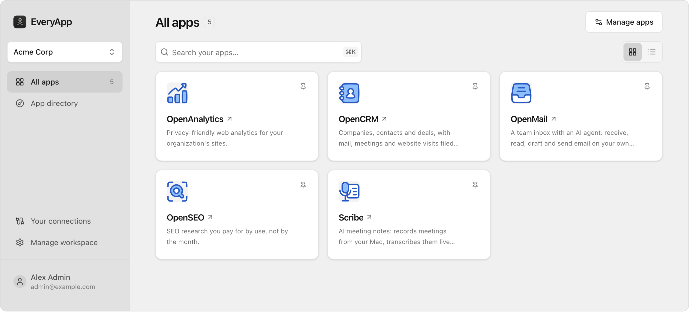

<p align="center">
  
</p>

<h1 align="center">Awesome EveryApp</h1>

<p align="center">
  Open source apps for your <a href="https://github.com/every-app/every-app">EveryApp</a> Gateway.<br>
  One command installs each, in your own Cloudflare account.
</p>

<p align="center">
  <a href="#apps">Apps</a> ·
  <a href="#set-up-a-gateway">Set up a Gateway</a> ·
  <a href="#install-an-app">Install an app</a> ·
  <a href="#share-your-app">Share your app</a> ·
  <a href="https://discord.gg/c9uGs3cFXr">Discord</a>
</p>

<p align="center">
  <picture>
    <source media="(prefers-color-scheme: dark)" srcset="assets/launcher-dark.png">
    
  </picture>
</p>

EveryApp gives your team one private place for its apps. You set up a Gateway in your own Cloudflare account, your team signs in once, and every app you install is there. Connect Claude or ChatGPT and your assistant can use them too. Cloudflare's $5 a month Workers plan hosts hundreds of apps.

This is the list of apps you can install. Run one as it is, have your agent change it, or build your own and add it here.

```bash
everyapp install https://github.com/every-app/open-seo
```

A directory is coming to the Gateway itself. Until it opens, this list is where apps are shared.

## Apps

Every app here installs with `everyapp install` and its GitHub URL. [Install an app](#install-an-app) has the steps.

### From EveryApp

| App | What it does | You'll need |
| --- | --- | --- |
| [OpenSEO](https://github.com/every-app/open-seo) | Keyword research, rank tracking and site audits, as an open source alternative to Semrush and Ahrefs. | An OpenRouter key and a DataForSEO key |
| [OpenCRM](https://github.com/every-app/open-crm) | Companies, contacts and deals, kept up to date by a research agent. | Nothing |
| [OpenScribe](https://github.com/every-app/open-scribe) | AI meeting notes for Mac. | An OpenAI key |
| [OpenAnalytics](https://github.com/every-app/open-analytics) | Web analytics for your sites, with no cookies. | Nothing |
| [OpenMail](https://github.com/every-app/open-mail) | An email inbox on your own domain, with an AI agent that drafts your replies. | A key for an AI model, such as OpenRouter, and a mail domain on Cloudflare |

### From the community

> [!WARNING]
> We haven't reviewed or tested these apps. Installing an app runs its code in your Cloudflare account, so read its repository before you install it.

| App | What it does | You'll need |
| --- | --- | --- |

No apps here yet. [Add the first one.](#share-your-app)

## Set up a Gateway

Already have one? Skip to [Install an app](#install-an-app).

A Gateway is the address where your team signs in and opens its apps, like `apps.yourcompany.com`. It runs in your own Cloudflare account. You need:

- A Cloudflare account on the Workers Paid plan, $5 a month. [Sign up](https://dash.cloudflare.com/sign-up), then [choose Paid](https://dash.cloudflare.com/?to=/:account/workers/plans).
- A domain on Cloudflare. [Buy one there](https://dash.cloudflare.com/?to=/:account/registrar/register), or [bring one you own](https://everyapp.com/docs/domain#use-a-domain-you-already-own).
- [Node.js](https://nodejs.org) 22.18 or newer.

Then run:

```bash
npm install -g everyapp
everyapp setup
```

`everyapp setup` logs you in to Cloudflare, asks which address to use, and creates your owner account. It takes about 15 minutes. If it stops, run it again and it picks up where it left off.

Or let your agent do it: the [quick start](https://everyapp.com/docs/quickstart) has one prompt to paste into Claude Code, Codex or Cursor, and every step in full.

> [!NOTE]
> EveryApp is in early development, so expect some rough edges. [For early adopters](https://everyapp.com/docs/early-adopters) says how to get help, and [Discord](https://discord.gg/c9uGs3cFXr) is where to ask.

## Install an app

1. Turn on R2 in your Cloudflare dashboard, once: R2 Object Storage, then Get started. Most apps store files there.

2. Run `everyapp install` with the app's GitHub URL:

   ```bash
   everyapp install https://github.com/every-app/open-crm
   ```

   It installs the app's latest release in your Cloudflare account and asks for any keys the app needs. If you skip a key, the app shows **Needs setup** until you run `everyapp configure <app>`.

3. Open your Gateway and sign in. The app is on your launcher.

To update an app, run its install command again. Your data stays.

To choose who else can open it, see [Invite people](https://everyapp.com/docs/people).

## Share your app

Built an app on EveryApp that other people could use? Add it to the list.

Your app needs three things:

1. **A public GitHub repository** with an open source license.
2. **A release**, so that `everyapp install https://github.com/you/your-app` works on a Gateway that has never seen the app. An app made with `everyapp create` publishes one every time you push to `main` on GitHub. In any other app, run `everyapp release` and attach `everyapp-release.tar.gz` to a GitHub release.
3. **A README** that says what the app does and which keys it needs.

Then open a pull request that adds one row to the end of the table under [From the community](#from-the-community):

```markdown
| [Name](https://github.com/you/your-app) | What it does. | What it needs |
```

- **What it does** is one plain sentence about what the app does, not how good it is. "Tracks invoices and reminds clients who are late."
- **You'll need** is what someone has to bring: API keys, accounts, hardware. Write "Nothing" if the app opens with nothing set.
- One app per pull request, titled `Add <App name>`.

Or hand it to your agent:

```text
Add my app to https://github.com/every-app/awesome-every-app. Read "Share your app"
in its README, check my repository against it, and open a pull request with my row.
```

Don't have an app yet? `everyapp create my-app` gives you a starter, and your agent builds the rest. [Create an app](https://everyapp.com/docs/create-an-app)

## More

- [EveryApp](https://github.com/every-app/every-app): the Gateway, the CLI and the SDK.
- [Docs](https://everyapp.com/docs), and [llms.txt](https://everyapp.com/llms.txt) for your agent.
- [Discord](https://discord.gg/c9uGs3cFXr): ask a question, or show what you're building.
